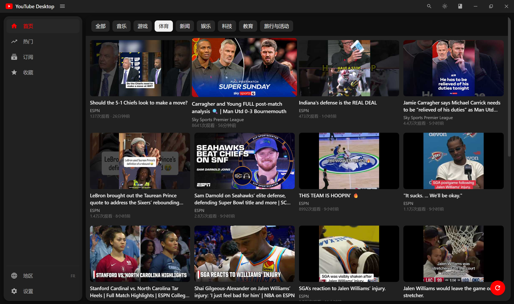

# YouTube Desktop

基于 **Tauri v2 + React 19** 的 YouTube 桌面客户端。数据层参考开源客户端 [FreeTube](https://github.com/FreeTubeApp/FreeTube) 的实现方式，直接走 YouTube 网页端 InnerTube 接口与频道 RSS——

> **无每日配额限制 · 无需 API Key · 无需 Google 登录 · 数据全部只存本机**



## 功能

- **首页**：22 个地区快捷切换，「全部」展示当地头部频道最新内容、「新闻」分类按地区搜索（RSS/搜索聚合，无配额概念）；分类 tab（音乐/游戏/体育等）
- **搜索**：多语言交错搜索 + 无限滚动；全局搜索弹窗（Ctrl+K）支持快速播放或进入搜索页平铺全部结果
- **订阅**：本地频道列表逐频道拉取 RSS 聚合更新流；支持粘贴频道链接 / `@handle` 自动解析添加，或导入 Google Takeout 的 `subscriptions.csv`
- **博主分组**：看板式分组页（[dnd-kit](https://dndkit.com/) 拖拽博主换组、列拖拽排序），订阅页侧栏按分组展示、可整体收起
- **收藏**：视频播放页五角星一键收藏（可选收藏分组），收藏页按分组管理
- **视频下载**：播放页选清晰度离线下载（144p~4K，mp4，1080p+ 自动 ffmpeg 合流），「离线视频」页查看进度、本地播放，无需联网
- **观看记录**：按日期分组展示近 7 天观看历史（本机 SQLite 存储，启动自动清理过期记录）
- **播放**：iframe 嵌入播放（走 WebView 代理），字幕自动翻译为简体中文，系统浏览器一键兜底；明暗双主题

## 安装

从 [Releases](https://github.com/WHF293/youtube-desktop/releases) 下载对应安装包：

- `YouTube Desktop_x.y.0_x64-setup.exe`（NSIS 安装包，推荐）
- `YouTube Desktop_x.y.0_x64_en-US.msi`

## 使用要点

1. **代理（必须）**：国内直连 YouTube 不可达，应用默认使用本地代理 `127.0.0.1:7897`（设置页可改）。数据与图片请求改后即时生效；**视频播放走 WebView 代理，修改后需重启应用**。
2. **添加订阅**：设置 → 订阅频道管理 → 粘贴频道链接（`youtube.com/@xxx`）或频道 ID；批量导入见下方「从 YouTube 导入订阅」。
3. **地区**：侧栏底部「地区」，影响首页「全部/新闻」的内容地区与搜索结果的地区倾向。
4. 视频若黑屏，可能为该视频限制站外播放，点播放器右上角按钮在系统浏览器中观看。

### 从 YouTube 导入订阅

1. 登录 [takeout.google.com](https://takeout.google.com/)，只勾选「YouTube 和 YouTube Music」→「订阅」，导出；
2. 解压后打开 `subscriptions.csv`，在 **设置 → 订阅频道管理 → 批量导入** 选择该文件（或直接粘贴 CSV 内容）；
3. 导入后到「订阅」页即可看到全部博主的最新视频聚合。

## 开发

```bash
pnpm install        # 安装依赖（Node 18+，Rust stable + WebView2）
pnpm tauri dev      # 桌面开发模式
pnpm tauri build    # 打包 msi / nsis 安装包
pnpm dev            # 仅前端（浏览器预览，InnerTube/RSS 因 CORS 不可用）
```

技术栈：Tauri v2 · React 19 · Zustand · Tailwind CSS v4 · TypeScript · dnd-kit · youtubei.js

架构概览：前端 `src/lib/innertube.ts` 封装 InnerTube（search / browse / next / 评论二段式）与 RSS 解析，
`src/lib/extract.ts` 负责下载抽流（youtubei.js + ANDROID_VR client），
Rust `src-tauri` 提供带代理的 HTTP 传输（`yt_fetch`）、图片转存（`yt_image`）、流式下载（更新包/视频分轨 + ffmpeg 合流）、
WebView 代理注入与本地库（tauri-plugin-sql）；
页面组件只依赖 `src/lib/youtube.ts` 门面，与数据来源解耦。

## 免责声明

本项目仅供个人学习与技术研究使用。使用非官方接口访问 YouTube 违反其服务条款，账号相关风险（如触发验证）请自行评估——建议使用小号。请勿用于商业用途。
